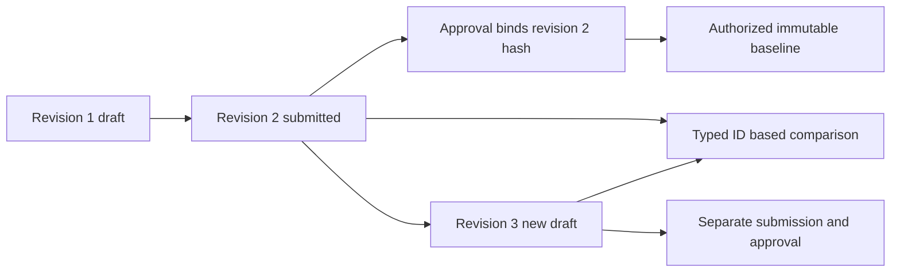

# M2 design

Status: proposed implementation design under the supplied M2 authorization. Runtime implementation awaits the M1 prerequisites in M2_HANDOFF.md. This document grants no production or deployment approval.

Keep Angular's existing shell and Project Service as its API boundary. Project Service owns all requirements persistence and authorization; Agent Service owns PM instructions and bounded generation, invoking the existing Gateway only. Agent Service has no database credentials, tools, repository execution, deployment capability or approval endpoint. Keep M1 APIs and pinned 0.2.0 snapshots compatible; publish additive 0.3.0 candidate contracts before consumers.

Project Service sends an authorized, bounded context snapshot and an explicit project-allowed model route to Agent Service. Agent Service returns validated proposals; Project Service validates again before committing. Avoid synchronous callbacks from Agent Service to Project Service during the request: durable state is loaded and saved by its owner. Agent execution and persistence acknowledgements are separate streaming events. Never report a proposal as saved before the owner transaction commits.

Use typed, versioned JSON as canonical document content. Include all 19 required PRD sections, stable requirement/epic/story/criterion IDs, provenance (confirmed, approved reference, suggestion, assumption, unresolved), explicit references and structured quality findings. Render Markdown deterministically from JSON. Manual editing uses structured fields; export is one-way Markdown. Arbitrary Markdown import is outside the initial editing path. Validate duplicate IDs, references, hierarchy, dependencies and acceptance criteria. AI findings remain rejectable suggestions.

Project Service adds Alembic tables for sessions/checkpoints, immutable document revisions and approval records; associate questions, requirements, epics, stories and findings with their owning session/revision, avoiding copies of M1 project/user state. Final normalized-versus-JSON layout must be selected against existing persistence conventions before implementing migration. Use owner/project checks on every nested operation, transactional optimistic concurrency and project-scoped idempotency records with request hashes. An operation retry replays its durable result; a changed payload with the same key conflicts. Concurrent operations cannot silently change the active revision. Interrupted execution is explicit and recoverable without authorizing a second mutation.

Each review decision binds project, document, revision, canonical content hash, human identity, timestamp, scope and comments. Approval requires current submitted revision plus matching expected hash/version, and is transactional with session state. No agent credential can submit a human decision. Approved JSON and approval history are immutable; an edit creates a new draft with a parent revision. Continuing discussion cannot alter that baseline. A later Architect/Planner may consume only an authorized approved revision. Rejection is an audited decision; its session returns to changes requested for revision. Keep development-only identity limitations visible and refuse production approval mode until real authentication exists.

Use an explicit bounded execution graph for discovery, clarification, draft/revision, stories and quality review. Adopt LangGraph only for stateful node/transition execution; Project Service remains checkpoint owner. Never add tools or an independent shared database. Profiles carry provider/model/settings/budget/timeout/rounds/retries/structured-output strategy. Validate outputs, retry a bounded number of times, return sanitized errors, and preserve deferred questions. Gate the deterministic adapter explicitly and label actual model provenance. Never perform provider fallback outside the project allowlist.

```mermaid
sequenceDiagram
    actor Human
    participant UI as Angular Requirements Studio
    participant Project as Project Service / PostgreSQL
    participant Agent as Agent Service / PM graph
    participant Gateway as LLM Gateway
    Human->>UI: Describe product / answer or defer question
    UI->>Project: Idempotent discovery command + expected version
    Project->>Project: Authorize and claim durable operation
    Project->>Agent: Bounded snapshot + permitted model route
    Agent->>Gateway: Bounded model invocation
    Gateway-->>Agent: Actual model + output
    Agent-->>Project: Typed, validated proposal / findings
    Project->>Project: Validate references and commit checkpoint
    Project-->>UI: Persisted questions / draft / execution status
    Human->>UI: Edit structured fields and save
    UI->>Project: New revision + expected version
    Project-->>UI: Immutable revision + hash
    Human->>UI: Submit / approve / reject / request changes
    UI->>Project: Human decision + revision + hash
    Project->>Project: Verify identity, freshness, hash; append audit record
    Project-->>UI: Baseline and history
```

```mermaid
stateDiagram-v2
    [*] --> DISCOVERY_STARTED
    DISCOVERY_STARTED --> GATHERING_REQUIREMENTS
    GATHERING_REQUIREMENTS --> CLARIFICATION_REQUIRED
    CLARIFICATION_REQUIRED --> GATHERING_REQUIREMENTS: answer or defer
    GATHERING_REQUIREMENTS --> READY_FOR_DRAFT
    READY_FOR_DRAFT --> DRAFT_GENERATED: validated PRD persisted
    DRAFT_GENERATED --> UNDER_REVIEW: human submission
    UNDER_REVIEW --> CHANGES_REQUESTED: reject or request changes
    CHANGES_REQUESTED --> DRAFT_GENERATED: new revision
    UNDER_REVIEW --> APPROVED: permitted human decision
    APPROVED --> DRAFT_GENERATED: explicit new draft; baseline retained
```





Deploy independently: existing Angular, Project Service, Gateway, PostgreSQL and new Agent Service images, each built from its own repository. Compose coordinates runtime only. No cloud deployment. Deterministic integration verifies restart persistence, stale writes/approvals and unrelated-project isolation through the actual browser and APIs.
